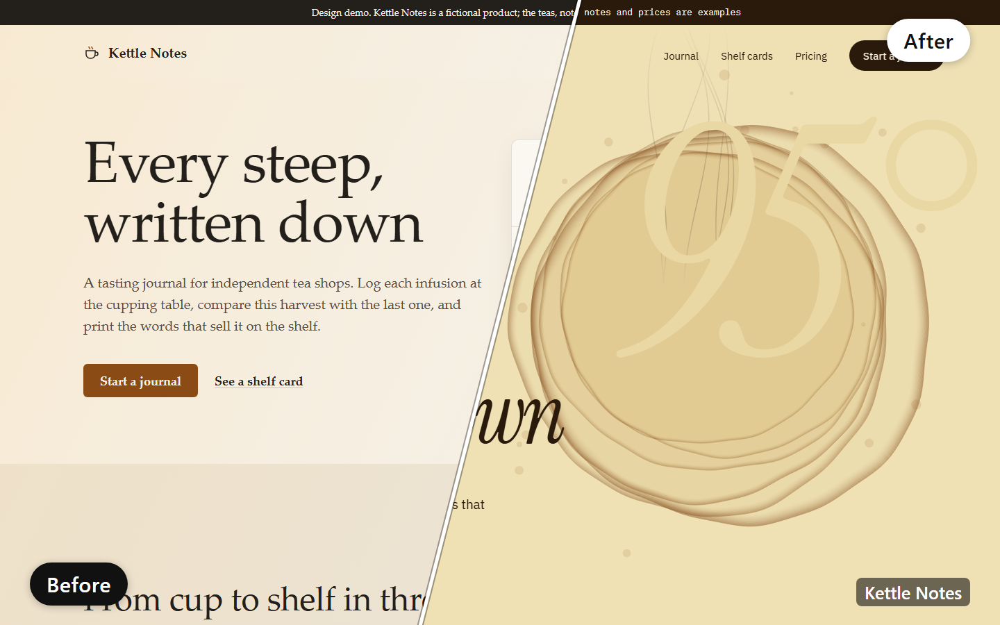
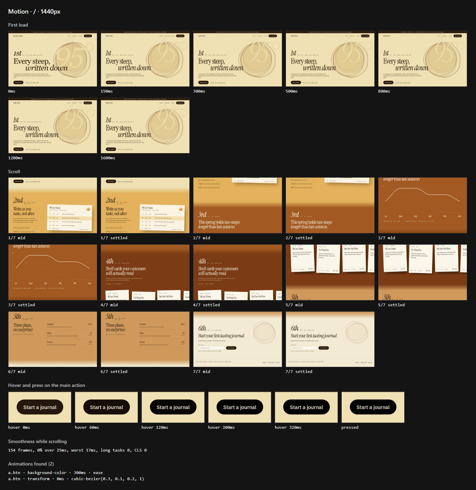

# Unswappable: a Claude Code skill for websites that don't look AI-generated

**Unswappable is an open-source Claude Code skill and plugin that designs, builds or redesigns a whole website around one idea only your product could use.** Swap in a competitor's logo and the site stops making sense. That's the test every design has to pass.

Most AI-built and vibe-coded websites look the same: a centered hero, a purple gradient, three feature cards, the Inter font. Unswappable starts from what your product *is*, builds every page and state from that idea, adds real motion, and has a fresh AI critic judge the result blind from screenshots. Then it checks accessibility, SEO and speed. On a redesign it ends with a before/after image for every page.



## Before and after: a full redesign

**Kettle Notes** is a fictional tasting journal for tea shops, made up for this demo. The "before" is the first version made by an earlier, template-driven version of this skill. The "after" is the redesign. Its idea is *the page steeps like tea*: the six sections are six infusions, so the page's color deepens from pale gold to dark amber and back as you scroll. The hero art is cup rings drawn from the tasting data, and steam drifts with your cursor.

<p align="center"></p>

Run it yourself: `npx serve examples/kettle-notes/after`, then open the address it prints. The brief, both versions and the concept are in [`examples/kettle-notes`](examples/kettle-notes).

## Why AI-built websites all look the same

Language models drift toward the most common design they have seen. Without a reason to do anything else, every page gets the same defaults. Most "anti-slop" prompts fix the symptoms: they ban purple and swap the font, but they leave the layout as it was. Unswappable fixes the cause. A site has to have an idea before it gets a style.

## How it designs a website: the swap test

1. **Research the product.** It reads your repo, files, live site, competitors and the words your customers use. It writes a brief with a source on every fact and maps every page and state.
2. **Write three concepts and kill the swappable ones.** Each concept comes from a different angle: your name, your material, your place, your process, or a system from your field. Any concept that would still work with a competitor's name is dropped. The boldest one that survives wins.
3. **Invent the layout.** There are no templates. It never repeats a hero shape or font pairing from an earlier site.
4. **Write the copy first,** with no invented customers, numbers or reviews.
5. **Build every page and every state:** inner pages, menus, the mobile nav, forms in error and success, empty and loading states, page transitions and the 404.
6. **Add a motion layer:** an entrance, scroll motion, feedback on every button, page transitions and one signature move. It stays smooth and switches off for visitors who prefer reduced motion.
7. **Get a blind design review.** A fresh AI critic sees only screenshots and motion filmstrips. It names the feeling before it is told the intent, says whether it would stop scrolling, and scores 13 criteria. The page passes only when originality and feeling score 4 or more.
8. **Verify and hand over.** It checks every page at six widths, then makes before/after images and puts every image in one `unswappable-output/` folder.

## Redesign an existing website with Claude Code

Point it at a URL or a project folder. It captures the current site first, so you keep the "before". It scores the current design blind, keeps your brand, finds the idea the site is missing, and rebuilds every page and state. Nothing is published or deployed without your yes.

## Base44 apps: a public landing page and your own login

Many Base44 apps make visitors log in before they see anything, so the landing page is hidden behind a login wall. When Unswappable finds a Base44 app, it:
- asks the owner before switching the app to public
- checks the data's security rules, so strangers can't read private records
- styles the app's own login, sign-up and password-reset pages
- keeps every private page behind login

Details are in [`base44.md`](skills/unswappable/references/base44.md).

## What it checks: accessibility, SEO, speed and motion

| Every control's states | Motion, as filmstrips |
| --- | --- |
|  |  |

| Script | What it checks |
| --- | --- |
| `verify.mjs` | Every page at six widths: overflow, WCAG 2.2 accessibility, SEO tags, page-weight budgets, robots and sitemap, a real 404 |
| `states.mjs` | Crawls every page, then hovers, focuses and clicks every control, opens menus, submits forms, films loading, checks the 404 |
| `motion.mjs` | Filmstrips of load, scroll and hover, plus an animation audit, scroll smoothness and a reduced-motion check |
| `design-audit.mjs` | Squint and grayscale renders, and design metrics for the critic |
| `beforeafter.mjs` | Captures the old and new site, and makes diagonal before/after PNGs |
| `with-server.mjs` | Starts a local server, runs a check, always stops it |

## Install the Claude Code plugin

```
/plugin marketplace add itsdanylol/unswappable
/plugin install unswappable@unswappable
```

Or copy the skills into `~/.claude/skills`:

```bash
git clone https://github.com/itsdanylol/unswappable
cd unswappable
./install.sh            # macOS / Linux
.\install.ps1           # Windows PowerShell
```

The scripts need **Node 18+** and **Playwright with Chromium**. The installers set them up, or run `npm install && npx playwright install chromium` in the repo.

## Use it

Ask Claude in plain words, or call the skill:

```
/unswappable make a site for my pottery studio
/unswappable redo https://example.com
```

It stops once to show you the concept, the feeling it is going for, and a one-screen style tile. Say "just do it" to skip that stop.

## FAQ

**How do I make my AI-generated website not look AI-generated?**
Give it an idea before a style. Unswappable writes three concepts from your product's own world, drops any that a competitor could also use, and builds every page from the winner. A blind critic then checks whether the result looks like something it has seen many times before.

**Why do vibe-coded websites all look the same?**
The models fall back on the most common defaults: a centered hero, gradients, card grids and the Inter font. Swapping colors doesn't change that. A concept that shapes the layout, type, imagery and motion does.

**Can Claude Code redesign my existing website?**
Yes. Give it the URL or the code. It captures the old site, keeps your brand, redesigns every page and state, and makes before/after images.

**Does it work with Base44 apps that require a login?**
Yes. With the owner's permission it makes the landing page public and styles the app's own login, while private pages and data stay protected.

**Is it a template or a website builder?**
Neither. It's a skill that guides Claude Code through research, concept, build, review and verification. It has no templates. Every layout is invented from the concept.

**Does it check accessibility and SEO?**
Yes. It checks every page at six widths for WCAG 2.2 issues, SEO tags, page weight and a real 404, and every control's hover and focus states.

**What does it bundle?**
[unslop](https://heydamir.design/unslop) by Damir Sokolovsky for cleanup, plus skills for copywriting (`marketing`), charts (`dataviz`) and running sites locally (`run`).

**Can I use it commercially?**
Yes, under CC BY 4.0, as long as you give credit (see below).

## How to credit

Unswappable is licensed under **[CC BY 4.0](https://creativecommons.org/licenses/by/4.0/)**. You may use, change and share it, including commercially, **but you must give credit**: name the project, link to it and to the license, and say if you changed it.

> Built with [Unswappable](https://github.com/itsdanylol/unswappable) by itsdanylol, licensed under [CC BY 4.0](https://creativecommons.org/licenses/by/4.0/). Includes [unslop](https://heydamir.design/unslop) by Damir Sokolovsky (CC BY 4.0).

If you ship a modified version, add "Modified from the original." The bundled skills and the ideas adapted from other projects are credited in [NOTICE.md](NOTICE.md).

## License

[CC BY 4.0](LICENSE). © 2026 itsdanylol and the contributors credited in [NOTICE.md](NOTICE.md).
