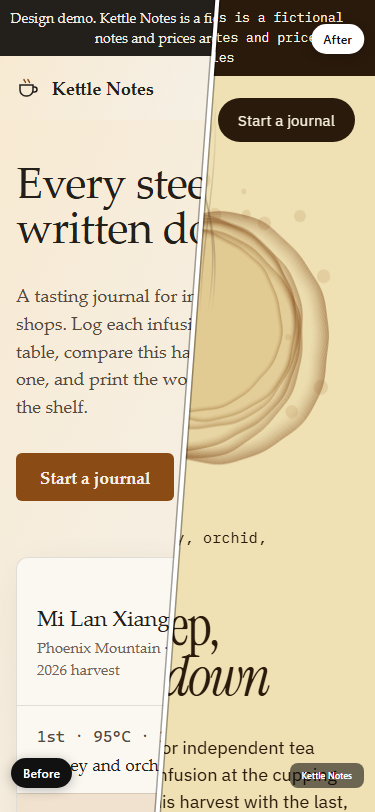
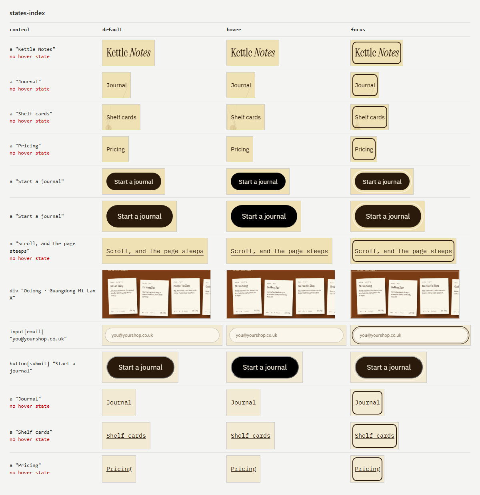

# sitecraft

**A Claude skill that builds or redesigns a whole website around one original idea, then proves it looks good and works.**

Most AI-made sites look the same: a centered hero, three cards, a gradient. sitecraft starts from an idea instead of a template. It finds what the product *is*, builds every page and state from that idea, gives the site real motion, and has a fresh critic judge the result blind before checking accessibility, SEO and speed. On a redesign it ends with before/after images like this one.


> **Kettle Notes** is a fictional tasting journal for tea shops, made up for this demo. The concept sitecraft chose: *the page steeps like tea*. The six sections are six infusions, so the page's color deepens from pale gold to dark amber and back as you scroll. The hero art is cup rings drawn from the tasting data.
> **See it yourself:** `npx serve examples/kettle-notes/after` (or `python -m http.server -d examples/kettle-notes/after`), then open the address it prints.
> The "before" is the first version made by an earlier, template-driven version of the skill.

<p align="center"></p>

## What it does

1. **Learns the product.** It reads the repo, files, live site, competitors and the words customers use, and writes a brief with a source on every fact. It maps every page and every state.
2. **Finds the idea.** It writes three concepts from different angles: the name, the material, the place, the process, or a formal system. It throws out any concept a competitor could also use, keeps the boldest one that survives, and invents the layout. There are no templates, and it never repeats a layout from an earlier site.
3. **Writes the words** before the layout, with no invented customers, numbers or reviews.
4. **Builds every page and every state.** That covers inner pages, menus, the mobile nav, forms in error and success, empty and loading states, page transitions and the 404. The concept carries into all of them.
5. **Adds a real motion layer:** an entrance, scroll motion, feedback on every control, page transitions and one signature move. It stays smooth and switches off for visitors who prefer reduced motion.
6. **Gets a blind review.** A fresh AI critic sees only screenshots and motion filmstrips. It names the feeling before it is told the intent, says whether it would stop scrolling, and scores 13 criteria. The site has to pass on originality and feeling, not only polish.
7. **Verifies.** It checks every page at six widths: accessibility (WCAG 2.2), SEO, page weight, security headers, every control's hover, focus and click, forms and the 404.
8. **Hands over.** On a redesign it makes diagonal before/after PNGs for every page and gathers every image into one `sitecraft-output/` folder.

**Base44 apps.** If the site is a Base44 app hidden behind a login wall, sitecraft asks the owner for permission first. Then it makes the landing page public, checks that the data's security rules still protect private records, styles the app's own login pages, and keeps private pages behind login. See [`skills/sitecraft/references/base44.md`](skills/sitecraft/references/base44.md).

## What it checks, in pictures

| Every control's states | Motion you cannot watch, as filmstrips |
| --- | --- |
|  |  |

## Install

**As a Claude Code plugin** (recommended):

```
/plugin marketplace add itsdanylol/sitecraft
/plugin install sitecraft@sitecraft
```

**Or copy the skills** into `~/.claude/skills`:

```bash
git clone https://github.com/itsdanylol/sitecraft
cd sitecraft
./install.sh            # macOS / Linux
.\install.ps1           # Windows PowerShell
```

The scripts need **Node 18+** and **Playwright with Chromium**. The installers set it up, or run `npm install && npx playwright install chromium` in the repo.

## Use

Ask Claude in plain words, or call the skill directly:

```
/sitecraft make a site for my pottery studio
/sitecraft redo https://example.com
```

It stops once to show you the concept, the vibe and a one-screen style tile. Say "just do it" to skip that stop. It never publishes, deploys, buys anything or changes app settings without your yes.

## What's inside

```
skills/
  sitecraft/   the orchestrator: SKILL.md, references, scripts
  unslop/      removes AI-looking UI and fixes the craft (by Damir Sokolovsky)
  marketing/   writes the copy from evidence
  dataviz/     honest charts in plain SVG
  run/         starts a local site and looks at it
examples/kettle-notes/   the demo: brief, before and after
docs/images/             README images
```

| Script | What it does |
| --- | --- |
| `verify.mjs` | Every page at six widths: overflow, accessibility, SEO tags, weight budgets, robots and sitemap, real 404 |
| `states.mjs` | Crawls every page, then hovers, focuses and clicks every control, opens menus, submits forms, films loading, checks the 404 |
| `motion.mjs` | Filmstrips of load, scroll and hover, plus an animation audit, scroll smoothness and a reduced-motion check |
| `design-audit.mjs` | Squint and grayscale renders, and design metrics for the critic |
| `beforeafter.mjs` | Captures the old and new site, and composes diagonal before/after PNGs |
| `with-server.mjs` | Starts a local server, runs a check, always stops it |
| `scan.sh` | A read-only inventory of a repo |

## How to credit

sitecraft is licensed under **[CC BY 4.0](https://creativecommons.org/licenses/by/4.0/)**. You may use, change and share it, including commercially, **but you must give credit**: name the project, link to it and to the license, and say if you changed it. For example:

> Built with [sitecraft](https://github.com/itsdanylol/sitecraft) by itsdanylol, licensed under [CC BY 4.0](https://creativecommons.org/licenses/by/4.0/). Includes [unslop](https://heydamir.design/unslop) by Damir Sokolovsky (CC BY 4.0).

Put that line in your README, docs or credits page. If you ship a modified version, add "Modified from the original."

The bundled skills and the ideas adapted from other projects are credited in [NOTICE.md](NOTICE.md).

## License

[CC BY 4.0](LICENSE). © 2026 itsdanylol and the contributors credited in [NOTICE.md](NOTICE.md).
